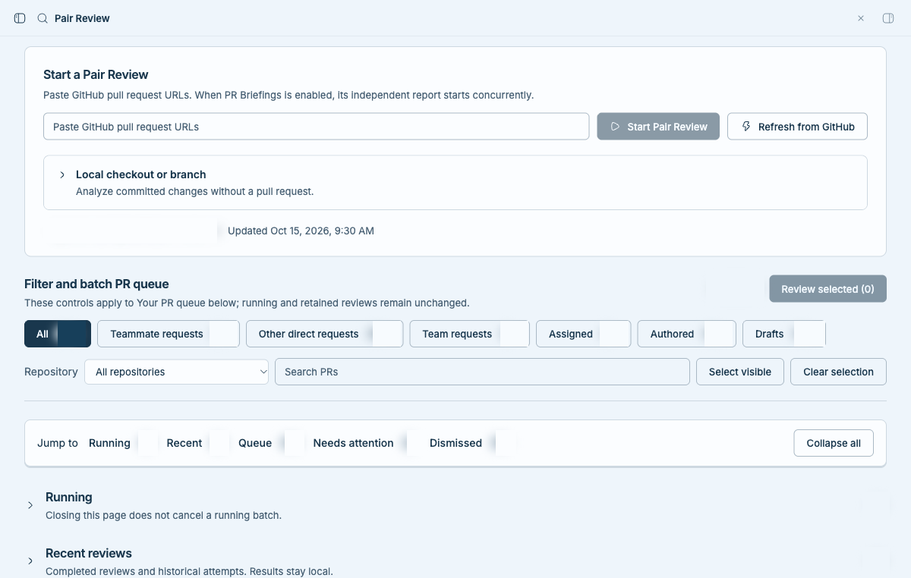
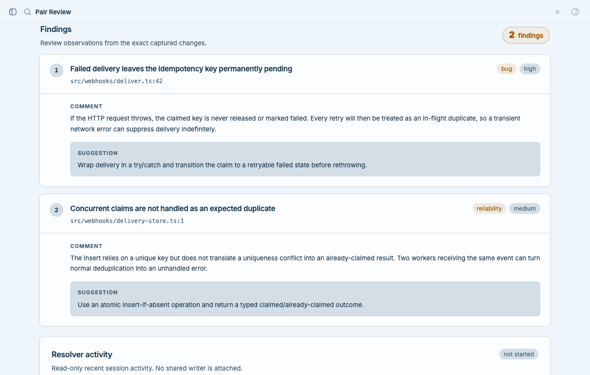
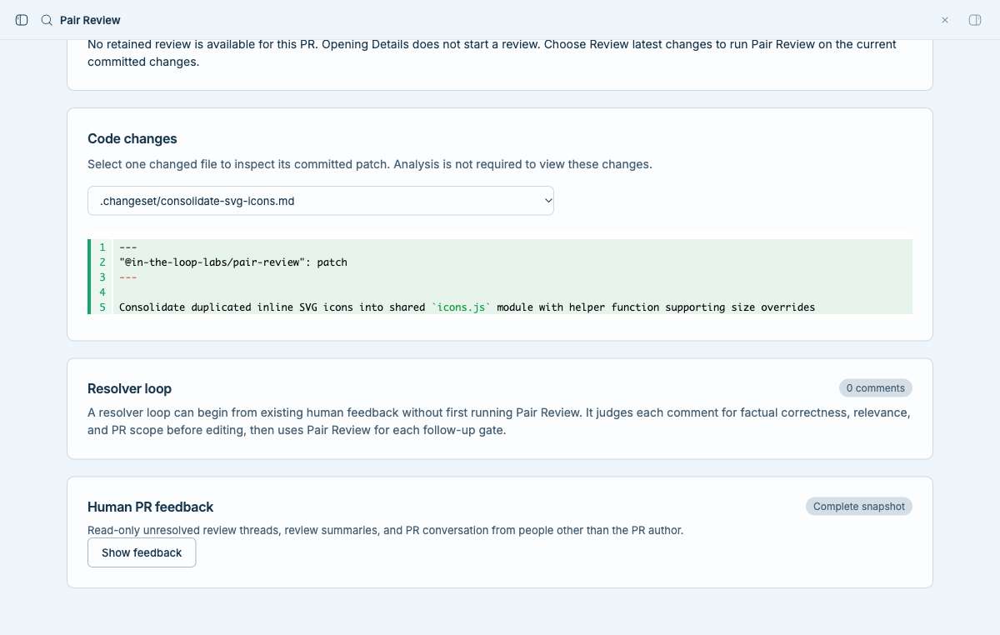
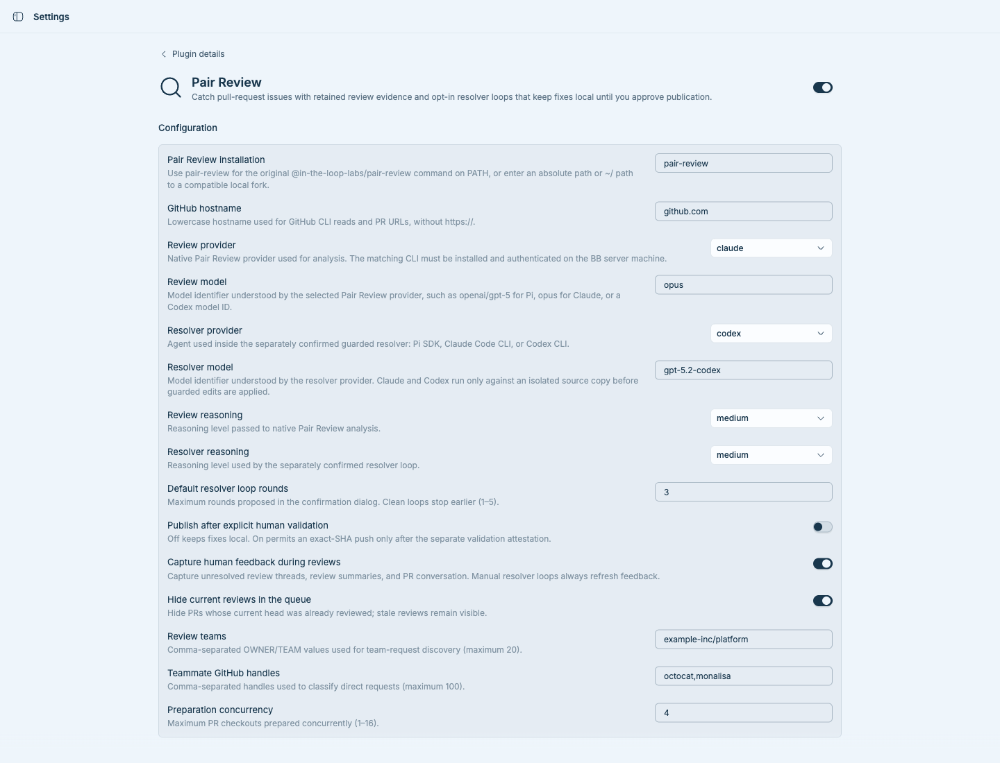

# Pair Review for BB

[Pair Review](https://github.com/in-the-loop-labs/pair-review) brings a local-first GitHub pull-request review workflow into BB. It discovers PRs that need your attention, runs either the original installed Pair Review app or a compatible local fork, preserves review evidence, and keeps resolver and publication actions behind separate confirmations.

## What you can do

- Browse review requests, assignments, authored PRs, team requests, and retained review runs from the **Pair Review** sidebar page.
- Inspect a PR's committed patch before analysis, then review Pair Review findings, human review feedback, activity, and retained results in **Details**.
- Start a review for one PR, a selected batch, or a local branch. Choose any native Pair Review analysis provider—including Claude Code, Codex, Copilot, OpenCode, Cursor, Pi, OMP, Antigravity, or Muse—and keep Pair Review's normal HOME, history, and shared SQLite database.
- Start a resolver loop only with an explicit confirmation. It evaluates each finding or human comment, edits an isolated checkout, reruns the full review, and stops early when clean or at the configured 1–5 round limit.
- Open the verified run in the native Pair Review app. Compatible running apps are reused; supported retained legacy runs can open in an isolated viewer.
- Optionally show PR briefings and recent review links when the separate **PR Briefings** and **Projects & Sections** plugins are installed.

Opening **Details** never starts analysis or resolution. Reviews remain local. Publication is off by default and is possible only after a resolver loop converges, the user gives a separate human-validation attestation, ownership and refs are rechecked, and the exact-SHA lease succeeds.

## Prerequisites

- BB `>=0.45` with Plugin SDK `>=0.6.15`, and an enrolled BB server machine.
- Node.js 24 or newer, Git, and GitHub CLI (`gh`) available on that machine's `PATH`.
- `gh` authenticated for the configured hostname with access to the PRs you review. Verify with:

  ```sh
  gh auth status --hostname github.com
  ```

- [`@in-the-loop-labs/pair-review`](https://github.com/in-the-loop-labs/pair-review), either installed so its `pair-review` command is on the BB server's `PATH`, or available as a local fork directory. Released versions 5.2.3 and 5.3.4 are accepted only at their verified adapter fingerprints. Other builds must expose the compatible machine-readable adapter contract; unknown or incompatible builds fail closed.
- The CLI and authentication required by your selected provider. Native reviews use Pair Review's own provider adapters and configuration. Claude and Codex resolver modes call `claude` or `codex` from the BB server's `PATH`; Pi resolver mode uses Pi's provider configuration.

Pi is not required for reviews or resolution when Claude Code or Codex is selected. Existing CLI subscription logins are used from their native credential stores. For safety, the guarded Claude/Codex resolver does not forward ambient provider API-key environment variables into the agent process; authenticate the CLI itself before starting a resolver loop. Queue browsing and committed-patch inspection use GitHub CLI reads and never invoke a model.

GitHub PR URLs must use HTTPS on the configured hostname. Cross-repository fork heads are not supported.

## Installation

Install the latest compatible 0.2 release from GitHub:

```sh
bb plugin install 'git:https://github.com/jgarrow-springhealth/bb-plugin-pair-review.git@^0.2.0'
```

BB shows the resolved source and asks for confirmation because third-party plugins run with full trust. Prefer a tagged release or explicit ref when one is available. For local development installs:

```sh
bb plugin install .
bb plugin reload pair-review
```

## Open and use Pair Review

1. Open **Pair Review** in the BB sidebar. It shows the last saved queue and how long ago it was refreshed. **Refresh from GitHub** repeats the read-only GitHub queries when you want newer results. The first run, and a change to the host, teams, or teammates settings, refresh automatically because no saved queue applies.
2. Filter by request type, repository, or text. Choose **Details** to inspect the patch without starting a review.
3. Choose **Review latest changes**, paste explicit PR URLs, or select several queue items and choose **Review selected**.
4. Open **Details** to inspect findings, source patches, saved feedback, and run activity. **Open Pair Review** opens the verified native run.
5. For a PR you authored, choose **Start resolver loop** and confirm the maximum rounds. Resolution never starts as a side effect of review.
6. If fixes converge, inspect every change and run behavioral validation before choosing the final validation action. With publication disabled, the commit stays in the isolated local checkout; with publication enabled, the guarded final action may push to the existing PR branch.

`bb pair-review status` prints the retained batch snapshot as JSON for read-only diagnostics.

## Configuration

Open **Settings → Installed plugins → Pair Review**, or use the **Pair Review settings** action in BB's sidebar footer. BB renders and persists the native settings form, validates values on save, and offers **Reset all to defaults** below it. The same values can be managed with `bb plugin config pair-review`.

| Setting | Default | Behavior |
| --- | --- | --- |
| Pair Review installation | `pair-review` | Use the original installed command from the BB server's `PATH`, or enter an absolute/`~/` directory for a compatible local fork. |
| GitHub hostname | `github.com` | Lowercase hostname used by PR validation and `gh`. |
| Review provider | `pi` | Native Pair Review analysis provider: Pi, Claude, Codex, Copilot, OpenCode, Cursor Agent, Antigravity, OMP, or Muse. |
| Review model | `openai/gpt-5` | Model identifier understood by the selected review provider; aliases such as `opus` are accepted by Pair Review. |
| Resolver provider | `pi` | Guarded resolver agent: Pi SDK, Claude Code CLI, or Codex CLI. |
| Resolver model | `openai/gpt-5` | Model identifier understood by the selected resolver provider. |
| Review reasoning | `medium` | Native review reasoning: off, minimal, low, medium, high, or xhigh. |
| Resolver reasoning | `medium` | Reasoning for the separately confirmed resolver. |
| Default resolver loop rounds | `3` | Proposed maximum, validated from 1 through 5. |
| Publish after explicit human validation | Off | Off keeps fixes local; on permits only the guarded exact-SHA publication path. |
| Capture human feedback during reviews | On | Captures complete unresolved review threads, summaries, and PR conversation when possible. Manual loops always refresh it. |
| Hide current reviews in the queue | On | Hides PR heads already reviewed while leaving stale heads visible. |
| Review teams | Empty | Up to 20 comma-separated `OWNER/TEAM` values for team-request discovery when Pi settings are absent. |
| Teammate GitHub handles | Empty | Up to 100 comma-separated handles for request classification when Pi settings are absent. |
| Preparation concurrency | `4` | Concurrent checkout preparation, validated from 1 through 16. |

Plugin settings choose the review and resolver providers and models. When present, the legacy `~/.pair-review/pi-settings.json` file still supplies team and teammate discovery metadata; it no longer overrides provider or model choices. No credential or token is a plugin setting.

## Permissions, data, and external services

- **GitHub:** discovery, PR metadata, diffs, and feedback use authenticated `gh` API reads. Plugin pages spend GitHub API quota only when you ask: opening Overview or leaving a PR page open makes no GitHub calls, and **Refresh from GitHub** is the explicit way to re-read. The first queue refresh makes about one API call per pull request plus a few searches. Later refreshes look up only pull requests GitHub lists as updated since the last refresh, so a refresh with no changes costs a handful of calls; reviews still read the live pull request. The signed-in login and each compare diff are remembered on disk (the diff by its exact commits, so it never goes stale). If GitHub rate-limits Pair Review, the page says when the limit resets and holds **Refresh from GitHub** until then; **Setup health** shows the remaining budget, and reading it costs no quota. Normal review execution does not submit reviews, comments, resolve threads, edit PR metadata, or merge. Enabling publication does not bypass the separate final confirmation and ref/ownership checks.
- **Local processes and files:** the trusted host worker runs the configured installed Pair Review command or local fork and uses Git in isolated retained directories. Evidence and checkouts live under `~/.pair-review/pi-batches`; Pair Review keeps its own configuration and database under `~/.pair-review`.
- **Model provider:** native reviews use Pair Review's selected provider adapter. The resolver uses Pi's constrained SDK tools or a Claude/Codex agent rooted in a sanitized temporary source copy; only validated existing-file edits are applied to the retained checkout. Claude runs in restricted mode with only read/edit tools. Codex runs under its `workspace-write` sandbox, which blocks writes outside the copy and direct network access but may allow read-only host paths according to the installed Codex policy. Provider credentials remain in native stores, not BB plugin settings.
- **Optional BB plugins:** PR Briefings and Projects & Sections add integrations when installed; Pair Review works without them.

Repository content, comments, findings, diffs, and tool output are treated as untrusted input. The resolver has no shell, network, repository credentials, or GitHub-write tool.

## Contributing

Contributions are welcome. Bug reports and pull requests go to
[jgarrow-springhealth/bb-plugin-pair-review](https://github.com/jgarrow-springhealth/bb-plugin-pair-review).
For larger changes, open an issue first so the approach can be agreed before
you invest in it.

### Set up a checkout

You need the [prerequisites](#prerequisites) above plus npm. Then:

```sh
git clone https://github.com/jgarrow-springhealth/bb-plugin-pair-review.git
cd bb-plugin-pair-review
npm ci --ignore-scripts
node scripts/link-host.mjs   # contributor test setup; not an end-user step
bb plugin install .          # run BB's copy of the plugin from this checkout
```

`link-host.mjs` links a development checkout to a locally installed `@earendil-works/pi-coding-agent` package so tests can resolve the optional Pi resolver SDK. By default it looks under the global npm root; contributors can instead set `PI_HOST_ROOT` to that package directory. Clean GitHub plugin builds and normal Claude/Codex use do not run the script.

`bb plugin install .` registers the directory in place. Confirm BB is running your checkout, not a Git release:

```sh
bb plugin source pair-review   # expect: path:/…/bb-plugin-pair-review
```

### Get your changes into BB

BB does not watch a path install by default. What you need to do depends on what you changed:

| You changed | To pick it up | Why |
| --- | --- | --- |
| `app.tsx`, `app.css`, `ui/`, `components/`, or a module the page imports at runtime (`queue.ts`, `time.ts`, `github-limits.ts`) | `bb plugin build . && bb plugin reload pair-review` | The page is compiled into `dist/app.js` and `dist/app.css`. |
| `host.ts` | `bb plugin build . && bb plugin reload pair-review` | The host worker is bundled into `dist/host.js`. |
| `server.ts`, `contract.ts`, or `sidebar-rows.ts` | `bb plugin reload pair-review` | Path installs load the server entry as TypeScript when the plugin loads, and the server validates RPC data with `contract.ts`. |
| `service.ts`, `cache.ts`, `engine/`, `bridge.mjs` | Nothing; the next request uses it | Each request starts a fresh `node bridge.mjs` from your checkout. |

When in doubt, build and reload. For active work, run the watch loop instead. It rebuilds and reloads on every save, and writes an unminified `dist/app.js` for readable stack traces:

```sh
bb plugin dev .
```

Then:

- **See the update:** open or refresh the **Pair Review** page; `bb plugin list` should show `pair-review` as `running`.
- **If the page didn't change:** run `bb plugin logs pair-review` to see why the load or build failed.
- **Before reloading:** check `bb pair-review status` and prefer reloading when no review is running.
- **Be careful with service and engine edits:** because they go live on the next request, a half-finished edit can affect reviews you start from BB in the meantime.

### Verify a change

```sh
npm run typecheck
npm test
npm run test:pair-review-compat  # set PAIR_REVIEW_EXECUTABLE for a specific build
npm run build                    # same as `bb plugin build`
```

Run `typecheck`, `test`, and `build` before every pull request. The compatibility suite (`compat/`) requires an actual Pair Review executable and is separate from the offline unit and UI tests; run it when you change the engine, adapter detection, or anything that talks to Pair Review. Offline tests do not prove provider authentication, live GitHub access, native app startup, or guarded publication, so describe any manual checks you ran in the pull request.

### Project layout

| Path | What lives there |
| --- | --- |
| `app.tsx`, `app.css` | The **Pair Review** page: overview, details, dialogs, settings notes. |
| `ui/kit.tsx`, `ui/findings.tsx` | Display components: metrics, tabs, steps, timeline, the findings report. |
| `ui/controls.tsx` | Shared controls: icon buttons with tooltips (`IconAction`, `Hint`) and the styled dropdown (`Picker`). |
| `components/ui/` | BB registry primitives (button, dialog, select, tooltip, …). Update them from BB's registry rather than editing them by hand. |
| `server.ts` | Plugin backend: RPC handlers, settings, realtime updates, CLI command. |
| `contract.ts` | Shared RPC and data contracts used by the page, server, and host. |
| `cache.ts`, `github-limits.ts` | On-disk caches that spare GitHub's rate limit (login, diffs, unchanged pull requests) and rate-limit detection. |
| `host.ts`, `bridge.mjs`, `service.ts` | Full-trust host worker and the bridge that runs each request through `service.ts`. |
| `engine/` | Pair Review execution, Git checkouts, the resolver loop, and guards. |
| `tests/` | Offline unit and UI tests (Vitest + Testing Library). |
| `compat/` | Compatibility tests against a real Pair Review installation. |

### Conventions

- **Safety boundaries are features.** Opening Details never starts analysis, review never starts resolution, and publication keeps its separate confirmations and checks. Changes that touch these paths need tests that prove the boundary still holds.
- **Treat repository content as untrusted.** Comments, findings, diffs, and tool output are data, never instructions, in code and in prompts.
- **Styling uses BB's tokens.** `bb plugin build` compiles Tailwind against BB's theme, so prefer utilities and semantic colors (`text-muted-foreground`, `bg-surface-recessed`, `text-warning-text`) over hard-coded colors. Page styles in `app.css` stay inside `@layer components` so utilities can override them. Responsive rules use the `pr-page` container query, because BB's sidebar and panels can leave a wide window with a narrow pane.
- **Icons must be BB icon names**, such as `AlertTriangle`, `RotateCcw`, or `ExternalLink`. Unknown names silently render as BB's Zap fallback.
- **Icon-only buttons need a label.** Use `IconAction`, which sets the accessible name and shows it as a tooltip. The shared `Button` deliberately omits native `title` tooltips.
- **Use `Picker` instead of a native `<select>`.** In tests, drive it with `choose()` and read it with `shown()` from `tests/picker.ts`.
- **Overview tests pick a tab first.** The overview remembers its tab between visits, so each test selects the tab it needs instead of relying on the default.
- **Credit adapted code.** If you adapt third-party code, keep its license header, add it to [THIRD_PARTY_NOTICES.md](THIRD_PARTY_NOTICES.md), and include its license under `licenses/`.
- **Screenshots must be sanitized.** Only release screenshots rendered from fictional data, with no private repositories, handles, counts, or credentials, belong under `docs/screenshots/`. Capture the real UI with its RPC responses replaced by fixtures, and keep BB's sidebar out of frame because it lists your thread titles.

### Pull request checklist

- [ ] `npm run typecheck`, `npm test`, and `npm run build` pass.
- [ ] New behavior has tests; UI changes were checked in BB after a build and reload.
- [ ] Safety boundaries (no analysis on Details, no resolution on review, guarded publication) are unchanged or covered by new tests.
- [ ] User-facing changes are reflected in this README and `PLUGIN_OVERVIEW.md`.
- [ ] Any adapted third-party code is credited in `THIRD_PARTY_NOTICES.md`.

## Screenshots

These show the real production UI rendered with fictional data (a made-up
`acme` organization). No private repository, handle, or model output appears,
and no model or GitHub write was used for any capture.

The overview puts the start bar, the status summary with its request
breakdown, and the tabbed PR queue on one screen. Filter by request type or
repository, or select several pull requests to review as a batch:



A retained review groups its findings by file and orders them by severity.
Each expanded finding becomes its own card with its severity, location,
comment, and a concrete suggestion:



Details for a pull request that has not been reviewed show the committed patch
behind a changed-file selector, human feedback, and the resolver-loop boundary,
without starting an analysis:



The native BB settings page exposes Pair Review's validated configuration.
Credentials remain in their native stores; none appear here.



Private development captures are intentionally excluded from this public tree. Only sanitized release screenshots belong under `docs/screenshots/`.

## License

The BB plugin code in this repository is MIT licensed © 2026 Janessa Garrow.
See [LICENSE](LICENSE). The separately installed Pair Review application has
its own license and distribution terms.
